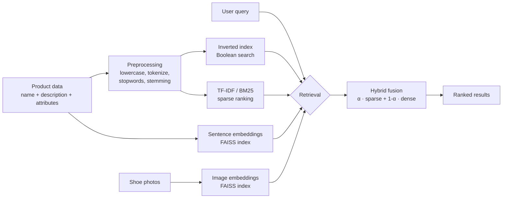

# 👟 SoleSearch

**A hybrid & multimodal shoe search engine** — find shoes by typing what you want, filtering with Boolean logic, or searching by photo.

*Boolean · TF-IDF · BM25 · Dense Retrieval · Hybrid Fusion · Image Similarity*


> 🇮🇩 **Ringkasan:** SoleSearch adalah mesin pencari sepatu yang membandingkan berbagai model *Information Retrieval* (Boolean, TF-IDF, BM25, dense retrieval, hybrid) pada satu koleksi 9.219 produk sepatu, lengkap dengan evaluasi kuantitatif dan pencarian berdasarkan gambar. Dibuat sebagai proyek mata kuliah **Sistem Temu Kembali Informasi (STKI)**, Universitas Dian Nuswantoro.

---

## ✨ What is SoleSearch?

Searching for a product is harder than it looks. A shopper types *"comfy black running shoes for men"*, but the product page says *"cushioned footbed, rubber outsole, sports shoe"*. Exact keyword matching misses this, while semantic search can miss precise terms like brand names.

SoleSearch puts the main retrieval approaches **side by side** on the same collection so you can see where each one succeeds and where it fails, and then combines them into a hybrid ranker.

### Planned features

- 🔎 **Text search** with TF-IDF, BM25, dense (semantic) retrieval, and a **hybrid** mode with an adjustable weight (α)
- 🧮 **Boolean filters**: `black AND sneakers NOT sandals`
- 🖼️ **Search by image**: upload a shoe photo and get visually similar shoes
- 📊 **Evaluation dashboard**: Precision@k, MAP, nDCG, MRR for every method

## 🧠 How it works



**Offline:** documents are cleaned, indexed (inverted index, TF-IDF/BM25 statistics, vector indexes). **Online:** the query goes through the same preprocessing, is scored by the chosen method(s), and the results are ranked and shown.

## 📚 Course concepts covered

| Feature in this project | Course topic (STKI) |
|---|---|
| Text cleaning, stopword removal, stemming | Document Preprocessing |
| Inverted index and Boolean queries (AND / OR / NOT) | Boolean Retrieval Model |
| TF-IDF weighting and cosine similarity | Vector Space Model |
| Sentence embeddings + FAISS | Dense Retrieval |
| BM25 ranking | Term Weighting (BM25) |
| Weighted sparse + dense fusion | Hybrid Search |
| Offline indexing / online querying pipeline | Search Engine Architecture |
| P@k, MAP, nDCG, MRR | Evaluation of IR Systems |

## 🗂️ Dataset

**Fashion Product Images Dataset** by Param Aggarwal ([Kaggle](https://www.kaggle.com/datasets/paramaggarwal/fashion-product-images-dataset)), originally collected from Myntra's product listings.

Only the **Footwear** category is used: **9,219 shoes** (casual shoes, sports shoes, heels, flip flops, sandals, formal shoes, flats, sports sandals).

Each shoe is turned into one searchable document made of its product name, brand, type, colour, usage, attributes and the cleaned product description (about 139 words per document on average).

> The dataset is used for academic, non-commercial purposes. It is **not redistributed** in this repository; see the Kaggle page for its license and terms.

### How relevance is judged

To evaluate the system without labelling thousands of results by hand, relevance is derived from product attributes (shoe type, colour, gender). A result counts as relevant when it matches the attributes the test query asks for.

## 🚧 Roadmap

- [x] Dataset selection and exploration
- [x] Build shoe corpus (text cleaning + thumbnails)
- [ ] Preprocessing pipeline + inverted index + Boolean search
- [ ] TF-IDF and BM25 (from scratch and library versions)
- [ ] Dense retrieval with sentence-transformers + FAISS
- [ ] Hybrid fusion with adjustable α
- [ ] Image similarity search
- [ ] Evaluation (P@k, MAP, nDCG, MRR) and analysis
- [ ] Web app (Streamlit/Gradio) and deployment
- [ ] Final report

## 📁 Project structure

```
solesearch/
├── data/            # processed corpus (shoes_corpus.csv)
├── notebooks/       # experiments and analysis
├── src/             # preprocessing, indexing, retrieval, evaluation
├── app/             # web application
├── reports/         # evaluation results and final report
├── requirements.txt
└── README.md
```

> The structure fills in as each stage is completed.

## 📈 Results

*Evaluation tables will be added here once the retrieval models are finished.*

| Method | P@5 | P@10 | MAP | nDCG@10 | MRR |
|---|---|---|---|---|---|
| Boolean | – | – | – | – | – |
| TF-IDF | – | – | – | – | – |
| BM25 | – | – | – | – | – |
| Dense | – | – | – | – | – |
| Hybrid | – | – | – | – | – |

## 🛠️ Tech stack

Python · pandas · NLTK · scikit-learn · sentence-transformers · FAISS · CLIP · Streamlit/Gradio

## 🙏 Acknowledgements

- Dataset: Param Aggarwal, *Fashion Product Images Dataset* (Kaggle), data originally from Myntra.
- Course: Sistem Temu Kembali Informasi (STKI) 2026, Universitas Dian Nuswantoro.

## 📄 License

Code is released under the [MIT License](LICENSE). The dataset is subject to its own terms.
